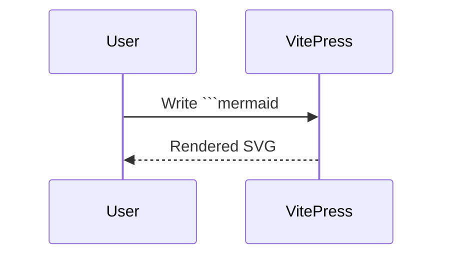

# Getting Started

Write a `pele` code block in Markdown using [Mermaid](https://mermaid.js.org) syntax:

````md
```pele
flowchart LR
  A[Markdown] --> B[markdown-it-pele] --> C[SVG]
```
````

It is rendered to SVG at build time, so the browser doesn't need to load any JS:

```pele
flowchart LR
  A[Markdown] --> B[markdown-it-pele] --> C[SVG]
```

## Configuration

`.vitepress/config.ts`:

```ts
import markdownItPele, { renderPele } from 'markdown-it-pele'
import { defineConfig } from 'vitepress'

export default defineConfig({
  markdown: {
    config(md) {
      md.use(markdownItPele, {
        lang: ['pele', 'mermaid'],
        render: block => `<div class="pele-diagram" v-pre>${renderPele(block)}</div>`,
      })
    },
  },
})
```

- `lang`: also handles ` ```mermaid `, so existing Mermaid docs work unchanged.
- `render`: VitePress compiles Markdown into Vue templates. Wrapping the output in `v-pre` keeps Vue from treating <code v-pre>{{ }}</code> in diagram text as interpolation.

## Mermaid code blocks



## Other code blocks are untouched

```ts
const answer = 42
```
